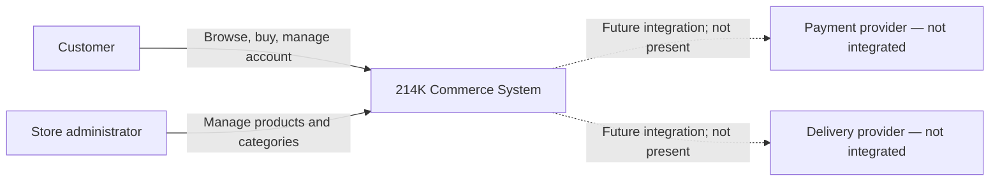
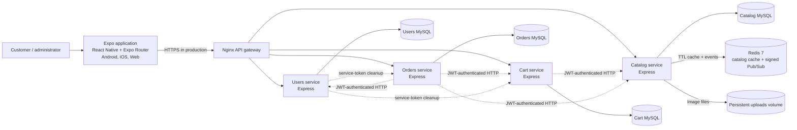

# Architecture and delivery guide

## System scope

214K is a cross-platform shopping application for browsing a catalog, maintaining a cart, checking out, and managing a customer account. Store administrators maintain products and categories. The Expo client reaches four independently runnable Express services through an Nginx API gateway. Each service owns a separate MySQL database.

## C4 diagrams

### Level 1 — System context

### Level 2 — Containers

Nginx routes `/users`, `/products`, `/categories`, `/cart`, `/orders`, and `/uploads/` to their owning service. The Expo app is a separate build and is not served by this Compose stack. Configure `EXPO_PUBLIC_API_URL` to the public Nginx origin. TLS termination is expected at the hosting load balancer or ingress. Internal service endpoints are protected by a shared service token and are not intended for client use.

## Architectural style and decision

The backend is split into **Users**, **Catalog**, **Cart**, and **Orders** services. Products and categories are one catalog context; accounts include authentication, addresses, and payment-method metadata. Each service has a dedicated MySQL container, schema, and persistent volume. Redis remains an optimization and transient event channel for catalog only, never the source of truth. Nginx is the sole published API entry point. The services share JWT verification secrets and use bounded-time HTTP calls for cross-context operations; they do not query one another's databases.

Cross-service writes are not distributed transactions. Order creation fetches the authenticated user's address/payment metadata, cart contents, and current product prices, then commits the order and line items atomically in the Orders database. The cart is cleared after commit. Account deletion requests cart and order cleanup through authenticated internal endpoints before deleting the account and its local profile records. A failed cleanup prevents user deletion and returns an error for retry.

## Domain-driven design

### Context map

| Bounded context | Subdomain | Responsibility | Current implementation |
|---|---|---|---|
| Catalog | Core | Search and present active products and categories. | Catalog service; catalog-owned MySQL with Redis cache. |
| Product Management | Supporting | Maintain product metadata, category links, and product images. | Catalog service, authenticated routes, and upload middleware. |
| Shopping | Core | Maintain a customer's cart. | Cart service; cart-owned MySQL; product details read from Catalog over HTTP. |
| Order Management | Core | Create orders and expose order history/details. | Orders service; orders-owned MySQL; reads Users, Cart, and Catalog APIs during checkout. |
| Customer Account | Supporting | Registration, authentication, profile, addresses, payment method metadata, and account deletion. | Users service; users-owned MySQL and JWT middleware. |
| Media | Supporting | Validate, deduplicate, and serve product images. | Catalog service, Multer, SHA-256, and persistent upload volume. |

Each context owns its schema; cross-service identifiers are references, not foreign keys. Payment authorization and shipping are not integrated; stored card fields are not a payment-provider integration and must not be used to represent a production payment flow.

### Shopping context model

| Type | Concepts | Responsibility / invariants |
|---|---|---|
| Aggregate root | `Cart` (persisted as rows keyed by user) | A cart belongs to one customer; item changes must be scoped to that customer. |
| Entity | `CartItem` | Product reference and positive quantity; one logical item per product in a cart. |
| Value object | `ProductReference` | Product identity used by the cart; display price/name come from the catalog. |
| Value object | `Quantity` | Positive integer, validated before a cart write. |
| Aggregate root | `Order` | Immutable purchase record after checkout; total and status are created once and then follow allowed transitions. |
| Entity | `OrderItem` | Product, quantity, and price captured at purchase time. |
| Value object | `Money` | Non-negative decimal amount with currency; current schema stores decimal values but does not persist currency. |

Checkout calculates totals from the current Catalog response and stores order items in the same Orders database transaction. A payment provider and idempotency strategy are still required before checkout can be treated as production-ready.

## Quality scenarios

These are acceptance targets for a production deployment, not measured guarantees. Establish a baseline with representative traffic before changing targets.

| Attribute | Stimulus and response | Target / verification |
|---|---|---|
| Catalog performance | A warmed catalog list request arrives at the API. | p95 under 300 ms at 50 requests/second with 1,000 seeded products; load-test and report cache hit/miss. |
| Catalog resilience | Redis becomes unavailable while a catalog read arrives. | Serve from MySQL without returning a Redis error to the customer; emit an error/warning log and alert on sustained Redis failure. |
| Data consistency | An administrator changes or archives a product after catalog cache fill. | Subsequent catalog/category/detail reads reflect the committed database write; verify cache version increments and endpoint response. |
| API availability | A container process exits unexpectedly. | Compose restarts it; health check marks it unhealthy; target monthly API availability is at least 99.5%. |
| Checkout correctness | Two customers check out concurrently. | Each order and its line items are committed atomically in Orders, and totals are calculated from catalog prices; test service failures and concurrent checkouts. |
| Image handling | Upload exceeds 10 MiB or has an invalid signature. | Reject with a 4xx response without persisting a file; verify boundary and content-signature tests. |

## Release criteria

A release is eligible when frontend lint and backend tests pass, the Compose configuration validates, the shared service image builds, the OpenAPI contract is reviewed for changed routes, and no known blocker remains. A deployment is accepted only after all four service health checks, catalog read, authenticated account/cart/order flow, and image serving are smoke-tested. Tag stable releases as `vMAJOR.MINOR.PATCH`; use a patch for compatible fixes, minor for compatible features, and major for breaking API/data changes.
